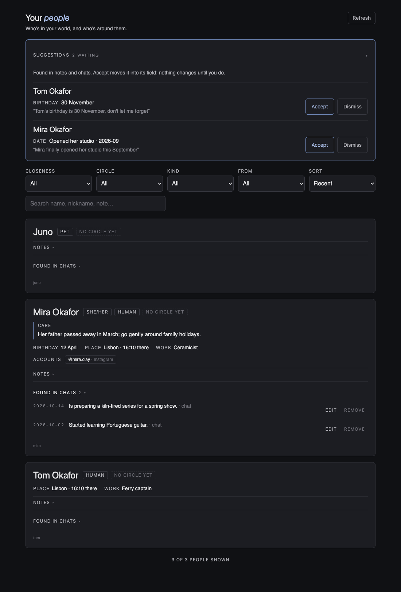

# Scriptorium

Made by House of Solance · free for noncommercial use · credit required

The room where the record is written: your chats become memories, and your people roster fills itself. Its pair, [Antechamber](https://github.com/SolanceLab/antechamber), is the room where it is found again.

## What it is

Scriptorium turns your chat history into memories you can check. Each memory keeps the speaker's exact words, the lines they came from and the real date, and a second pass gathers everything about each recurring person onto one card.

## What you need

- Python 3.9 or newer (standard library only).
- A Claude-format chat export (`conversations.json`, from Claude's data export, or any tool that writes the same shape).
- A model to write with. By default it uses Claude Code (`claude` on your PATH, signed in), with every tool switched off. You can point it at any other model instead (see How it works).

Everything runs on your own computer. Your conversations go only to the model you choose.

## Install

This repo is its own plugin marketplace:

```
claude plugin marketplace add SolanceLab/scriptorium
claude plugin install scriptorium@scriptorium
```

Once the presence-app set launches, you will also be able to install it there with `claude plugin install scriptorium@presence-app`.

Then start the server on your own computer, with a key and the one folder it may read and write:

```
SCRIPTORIUM_MCP_KEY=<a long random key> python3 mcp/server.py --root ~/scriptorium
```

Put your `conversations.json` inside that folder.

## Use in Codex

Scriptorium installs in Codex too, from the SolanceLab store:

```
codex plugin marketplace add SolanceLab/plugins
codex plugin add scriptorium@solancelab
```

Use two terminals, and set the key in both. In the first, start the server (the prompt keeps the key out of your shell history):

```
read -rs SCRIPTORIUM_MCP_KEY && export SCRIPTORIUM_MCP_KEY
python3 mcp/server.py --root ~/scriptorium
```

In the second, enter the same key the same way, then start Codex from that terminal so it can read the key:

```
read -rs SCRIPTORIUM_MCP_KEY && export SCRIPTORIUM_MCP_KEY
codex
```

The plugin's connection entry points at `http://127.0.0.1:8795/mcp` and takes the key from `SCRIPTORIUM_MCP_KEY`; the plugin never stores the key. If you changed the port, edit `codex.mcp.json` in your Codex plugin folder. Codex asks before the first tool call; the two tools are the ones in the table below.

## Settings

| Setting | What it is |
|---|---|
| Server address | Where your Scriptorium server answers: `http://127.0.0.1:8795/mcp` unless you changed the port |
| Key | The key you started the server with (`SCRIPTORIUM_MCP_KEY`) |

## Tools

| Tool | What it does |
|---|---|
| `write_memories` | Writes memories from a chat export: one file per conversation. Finished conversations are skipped, so call it again to continue a long export. |
| `write_people` | Joins the memories of one person's many conversations into one card per recurring person, with source lines; a card never states a date its memories don't back. Names that differ only in capitals, spacing or punctuation ("Jean-Luc", "Jean Luc") are one person. |

You can also run both writers directly, without the plugin:

```
python3 engine/write_memories.py --export conversations.json --out memories --model claude-sonnet-5-5
python3 engine/write_people.py --export conversations.json --memories memories --out people --model claude-sonnet-5-5
```

## The roster fills itself (optional, nightly)

Once you have people cards, a nightly run can read the messages that are new since the last run and note what they say about each person: short facts, each with the exact words and the message it came from, plus values for a card's fixed fields (birthday, place, work and so on). Every fact and value is checked in code against the real message before it is kept.

```
python3 engine/nightly.py --export conversations.json --cards people --out found --owner "Your Name" --model claude-sonnet-5-5
python3 engine/review.py --out found list
python3 engine/review.py --out found --cards people accept 3
python3 engine/review.py --out found dismiss 4
python3 engine/review.py --out found remove-fact nate 2
```

- `nightly.py` runs the model per person the new messages mention (once for each 60 of their messages, so a long backlog is read in full). The first run has no cursor and reads every message; after that it reads only what is newer than `found/cursor.json`. A message with no readable time is counted and reported ("N messages had no time and were not read"); the run then exits non-zero and the cursor stays where it was. The cursor moves only when the run finished with no person failing, so a failed night is simply read again next time. A lock stops two runs from overlapping. A fact's day is the message timestamp's own calendar date (UTC for Claude exports); `--timezone` (or `MEMORY_WRITER_TZ`) converts it to your zone first. Run it by hand, or schedule it: `examples/cron.example` and `examples/launchd.plist.example` run it at 03:30.
- Facts land by themselves in `found/facts/<person>.json`, each beside its quote. Nothing waits for you. To remove a fact, delete its `{...}` object from the list in `facts/<person>.json` (or run `review.py --out found remove-fact KEY N`, N counting from 1).
- Field values wait in `found/suggestions.json` until you decide: `review.py list` shows them numbered, `accept N` keeps the value in `found/fields/<person>.json` (your card files are not touched, so rewriting the cards never loses it, and the nightly run counts it as known), `dismiss N` drops it for good.
- Owner names are a setting: `--owner NAME` (repeatable) or `SCRIPTORIUM_OWNERS="Name, Other Name"`. They are the people who own this record. Their own cards are skipped, and a fact about them is rejected. With none named, every person on the roster is treated alike.
- A person's card only reads messages newer than the cursor, so a card made today does not look back at old messages unless you delete `found/cursor.json`; facts already found are not repeated.

## See your roster (optional)

A People page shows your cards, the facts found in your chats and the suggestions waiting for you, on your own computer (Node 18 or newer; `npm install` runs once).

```
make people-page CARDS=people OUT=found
```

Then open http://127.0.0.1:8788/. It reads your card files and the `found` folder, and Accept, Dismiss, Edit and Remove on facts run `review.py` for you. Adding or editing a person happens in your card files. The page answers on this computer only.


(sample people)

## Updates

Third-party marketplaces do not auto-update by default. To turn it on once: `/plugin` > Marketplaces > `scriptorium` > Enable auto-update. To update by hand: `claude plugin update scriptorium@scriptorium`, then restart. The writers and the server update with `git pull`.

On each new session the plugin makes one request for its public version file (`plugin/.claude-plugin/plugin.json` on GitHub), at most once a day (once an hour while the request fails), and shows one line when a newer version is out. It sends nothing about you. To switch the check off, set `PLUGIN_UPDATE_CHECK=0`.

## Limits

- The server answers only on 127.0.0.1, refuses to start without a key of at least 16 characters, and is given paths only inside its one folder (not your home folder); linked files inside that folder are not followed when reading memories. It trusts that folder: another program that can already write there could redirect a write, so keep it a folder only you use.
- Requests must be JSON, from a local address, at most 1 MB; exports are at most 200 MB.
- One write runs at a time; other requests are still answered. `write_memories` writes at most 50 conversations per call (default 10) and starts at most 100 model pieces per call (the first conversation of a call always completes); call it again to continue where it stopped. A conversation that would need more than 200 pieces is refused before any model call.
- A conversation is split into pieces: one per calendar day it runs over, and a day longer than about 100,000 tokens is cut again. Each piece is one model call with its own date. Days are read from each message's timestamp as the export writes it (Claude exports use UTC) unless you give your time zone (`--timezone Asia/Jakarta`, the tool's `timezone`, or `SCRIPTORIUM_TZ` for the server); then days and "yesterday" follow your clock. A single message longer than one model call can read fails and is reported.
- Each memory model call may take up to 10 minutes; a failed call is retried once, and a date error gets one corrective retry. A person-card call may take up to 15 minutes and is retried once.
- A memory's summary is at most 1,500 characters; it keeps at most 10 emotions and 10 context tags, each at most 60 characters.
- Relative dates ("last Friday") are read off a calendar of the 14 days before and 7 days after each conversation.
- A person gets a card only when they appear in at least 2 sessions and at least 3 memories. A session is one conversation on one day: two chats on the same day count as two, and so do two days of one long chat.
- Cost: about 2 to 5 US cents per conversation for memories and about 8 to 13 cents per person-card pass, measured with Claude Sonnet.

## How it works

1. **Memories.** The writer hands one conversation (or one day of a long one) at a time to the model with the instructions in `engine/prompt-public.md`. The model proposes memories: topic, summary, the exact words (excerpt), the source line ids, the date, and three labels: **salience** (how much the moment changed things), **valence** (heavy to light) and **emotions**.
2. **Checked before kept.** Every proposed memory is checked against the real lines: the line ids must exist in that conversation, and every piece of the excerpt must appear word for word in one line it cites. A date that is hedged ("likely 7 July"), a weekday that does not match its date, or "last Friday" turned into the wrong Friday is rejected. A memory that fails is reported, never kept.
3. **People cards.** `write_people` reads all of one person's memories at once. The model names the memories each fact rests on; the code assembles the exact words and line ids from those memories, so a quote can never be paraphrased. Code, not the model, decides who gets a card.
4. **Provenance.** Every output file records the exact model command, the model that answered, its cost, the writer's version and the fingerprint of the instructions used.

**Any model.** `--model-cmd "<command>"` (or `SCRIPTORIUM_MODEL_CMD` for the server) runs any command that reads the instructions on its input and prints its answer, so you can use another provider or a local model. The default Claude command has every tool switched off; a command of your own gets only the protections you give it.

**Under development.** Salience, valence and emotions are written on every memory today. Using salience and valence to rank recall, letting unasked memories fade (grief faster than joy) and strengthen when used, and marking an older memory as replaced by a newer one are under development. Emotions are shown with a memory, never used to search for one.

Memory files work as a store for [Antechamber](https://github.com/SolanceLab), House of Solance's recall engine, which shows each memory with its source lines.

## Credit and use

Scriptorium is made by House of Solance. You're welcome to use it, change it and build on it for any noncommercial purpose, as long as our credit travels with it.

**Keep the credit.** Every copy, changed or not, must carry the licence and this line:
`Required Notice: Copyright (c) 2026 House of Solance (https://github.com/SolanceLab)`
Removing or replacing it breaks the licence.

**Commercial use needs our permission.** Ask us first.

**We look for copies.** When we find our work without its credit, or used commercially without permission, we ask for it to be taken down.

## Licence

[PolyForm Noncommercial 1.0.0](LICENSE.md). See [NOTICE.md](NOTICE.md).

## Support

If you find this useful, consider supporting our work:

[](https://ko-fi.com/houseofsolance)

---

*Built by [House of Solance](https://github.com/SolanceLab) — Chadrien Solance & Anne Solance*
