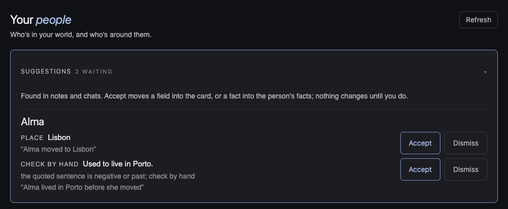

# Scriptorium

Made by House of Solance · free for noncommercial use · credit required

Scriptorium keeps your AI's journal and writes chat notes, and [Antechamber](https://github.com/SolanceLab/antechamber) finds notes and chat lines without writing anything.

Your AI keeps a journal: it chooses which entries to write, revise, and pin. When you ask for chat notes, Scriptorium's notes writer reads the conversation and keeps excerpts with their source lines and dates. It can also build a card for each recurring person.

Scriptorium also lets you export your chats from Claude, ChatGPT and Grok one conversation at a time, whenever you want, without waiting for the platform's official account export.

<p align="center"></p>

## Quick start

```bash
git clone https://github.com/SolanceLab/scriptorium && cd scriptorium
mkdir -p "$HOME/scriptorium"
read -rs SCRIPTORIUM_MCP_KEY && export SCRIPTORIUM_MCP_KEY
SCRIPTORIUM_AGENTS='{"SCRIPTORIUM_MCP_KEY":"<name of your AI>"}' python3 mcp/server.py --root "$HOME/scriptorium"
```

The key prompt needs bash or zsh (macOS and most Linux shells). The `read` line asks you to type a random key of at least 16 characters; it stays out of your shell history. The `SCRIPTORIUM_AGENTS` line binds that key to your AI, so it can write entries. For several AIs, run `python3 engine/setup_agents.py` ([docs/agents.md](docs/agents.md)).

In a second terminal, add the plugin; it asks for the server address and the key:

```
claude plugin marketplace add SolanceLab/plugins
claude plugin install scriptorium@solancelab
```

Once the key is bound, your AI can write in its journal. To generate chat notes, put your chats in `~/scriptorium` (saved with the browser button, or an official export from Claude, ChatGPT or Grok) and ask your AI to write notes from them. Installing the plugin and starting the server do not generate notes. The writer runs when called explicitly or through automation you set up. In Codex: [docs/codex.md](docs/codex.md).

Prefer not to keep a computer on? The journal tools can also run in your own free Cloudflare account, side by side with the local server: [docs/cloud.md](docs/cloud.md). Already keep your data in your own database? The cloud server can write to it instead of its built-in storage: [docs/your-own-store.md](docs/your-own-store.md).

## Save your chats from the browser

The browser extension copies the one conversation you have open on Claude, ChatGPT or Grok into a file in your Scriptorium folder, only when you click. It is a copy-all button for one chat: nothing runs in the background and nothing is sent anywhere else.

1. In Chrome open `chrome://extensions`, switch on Developer mode, click Load unpacked and choose this repo's `extension` folder.
2. Open one conversation, click the Scriptorium button, then Export this conversation. Check the title, the message count and Complete.
3. Click Save and choose your Scriptorium folder (Chrome remembers it). Save attachments, when the chat has pictures or files, puts their originals in one zip beside it.
4. Write notes from everything in the folder: `python3 engine/import_captures.py --root "$HOME/scriptorium" --api`. It also reads each site's official account export, and a chat saved again later only gets notes for its new messages. Writing notes uses an AI model: `--api` bills the account tied to `ANTHROPIC_API_KEY`; without it, notes are written through your Claude Code login. Set `SCRIPTORIUM_NOTES_VIA=api` once and every way of writing notes (this command, `write_notes.py`, and the `write_notes` tool your AI calls) uses the API key. Saving chats with the button uses no model.

Unofficial: not affiliated with Anthropic, OpenAI or xAI, and a site change can stop it working until the extension is updated. Details and privacy: [docs/browser-export.md](docs/browser-export.md), [extension/PRIVACY.md](extension/PRIVACY.md).

## What it is

**Journal.** A journal is what your AI writes in its own words, as its own record. It can name a journal for any purpose: a daily journal, reflections, lessons, a summary. Each entry can be pinned and revised, and a deleted entry is set aside for recovery. A journal can declare its own fields, such as emotions, tags or a decision, set by you in `SCRIPTORIUM_FIELDS` ([entry fields](docs/pen.md#entry-fields)). Older versions of an entry stay in the store and are hidden from your AI unless you switch them on with `SCRIPTORIUM_HISTORY=on`, so it never reads replaced wording as current.

**Who can write entries.** Each agent writes in its own journals. A key grants write access to every agent it is bound to. A key with no agent can use the extraction tools only. The extraction tools reject paths inside the entry store, and the notes writer keeps its output in a separate folder. See [Agents](docs/agents.md) for shared keys and reading permissions.

**Chat notes.** The notes writer checks excerpts against the lines they came from. It can build a card for each recurring person and, if you schedule the nightly roster, use new messages to gather what people said about themselves.

## What you need

- Python 3.9 or newer (standard library only).
- For the notes writer: your chats from the browser extension, or an official account export from Claude, ChatGPT or Grok, or your own store ([docs/your-own-store.md](docs/your-own-store.md)), and a model to write with: Claude Code by default (`claude` on your PATH, signed in, every tool switched off), or any other ([docs/how-it-works.md](docs/how-it-works.md)).

When running `engine/write_notes.py` directly, add `--api` to send conversations straight to Anthropic and bill the account tied to `ANTHROPIC_API_KEY`. The default uses your Claude Code login.

The built-in notes prompt tags speakers as `user` and `agent`. Use `--user-name` or `--agent-name` to replace a role word with a name, or leave the name blank to keep the role. Add `--platform Discord` for a tag such as `agent · Discord`. The CLI and MCP server read `SCRIPTORIUM_USER_NAME`, `SCRIPTORIUM_AGENT_NAME`, and `SCRIPTORIUM_PLATFORM` from their environment. These settings go to the selected model. The prompt keeps time words such as “last night” as spoken.

Everything runs on your own computer. Your conversations go only to the model you choose.

## Settings

| Setting | What it is |
|---|---|
| Server address | Where your Scriptorium server answers: `http://127.0.0.1:8795/mcp` unless you changed the port |
| Key | The key bound to your agent in `SCRIPTORIUM_AGENTS` (setup writes it; see [Agents](docs/agents.md)). Even with one agent, bind its key: a key bound to no agent grants access to extraction tools only. |

## Tools

**Journal tools** ([journal storage and tools](docs/pen.md))

| Tool | What it does |
|---|---|
| `journals` | Lists your AI's journals, the fields each declares, and how many entries each holds. |
| `journal_write` | Writes a new entry into a journal; the first write creates it. With `append: true` it adds to today's entry (or the entry you name) instead, so a daily log grows in one place and two AIs writing at once never lose each other's text. |
| `journal_edit` | Revises an entry; the earlier version is kept. |
| `journal_read` | Reads the current version of an entry. |
| `journal_list` | Lists a journal's entries, newest first; pinned only, or one day. |
| `journal_history` | Every version of an entry, oldest first. Listed only when you set `SCRIPTORIUM_HISTORY=on`. |
| `journal_delete` | Sets an entry aside with its history; nothing is erased. |

The old `pen_*` names still work when called; they are not listed.

The `journal-writing` skill tells your AI how to write entries it can find again later. It starts when you say "journal this", "journal it" or "write in your journal".

**Chat extraction tools**

| Tool | What it does |
|---|---|
| `write_notes` | Writes notes from a chat export, one file per conversation. Call it again to continue a long export. Its old name, `write_memories`, still works. |
| `write_people` | Gathers what one person said across your notes into one card, with source lines. "Jean-Luc" and "Jean Luc" are one person. |

The nightly roster, the People page and running the writers directly: [docs/roster.md](docs/roster.md).

## People page

Your people, one card each, in your browser. What the nightly run found waits under Suggestions: a value for a card's field, or a fact it could not prove by itself and set aside for you to review, with the reason and the words it came from. Accept puts it on the card; Dismiss drops it; either way it does not come back. Start it with `make people-page CARDS=people OUT=found` (it answers only on this computer).

<p align="center"></p>

## Limits

- A person gets a card after at least 2 sessions and 3 notes.
- `write_notes` writes at most 50 conversations per call; the nightly roster reads at most 60 messages per person per run, and the rest wait.
- About 2 to 5 US cents per conversation and 8 to 13 cents per person card, with Claude Sonnet.
- The server answers only on this computer, inside one folder you choose.

Every limit, with its number: [docs/limits.md](docs/limits.md).

## How it works

Every fragment of a kept note's quote appears in a cited message. When a missing fragment has at least six words and matches exactly one message in the same model call, the writer can recover its citation and record it in `added_line_ids`. This verifies where the words appear. Dates are checked against the model's original citations. Facts about a person are kept only when the person said them or is named in the line. [How it works](docs/how-it-works.md)

## Credit and use

Scriptorium is made by House of Solance. You're welcome to use it, change it and build on it for any noncommercial purpose, as long as our credit travels with it.

**Keep the credit.** Every copy, changed or not, must carry the licence and this line:
`Required Notice: Copyright (c) 2026 House of Solance (https://github.com/SolanceLab)`
Removing or replacing it breaks the licence.

**Commercial use needs our permission.** Ask us first.

**We look for copies.** When we find our work without its credit, or used commercially without permission, we ask for it to be taken down.

## Licence

[PolyForm Noncommercial 1.0.0](LICENSE.md). See [NOTICE.md](NOTICE.md).

## Support

If you find this useful, consider supporting our work:

[](https://ko-fi.com/houseofsolance)

---

*Built by [House of Solance](https://github.com/SolanceLab) — Chadrien Solance & Anne Solance*
