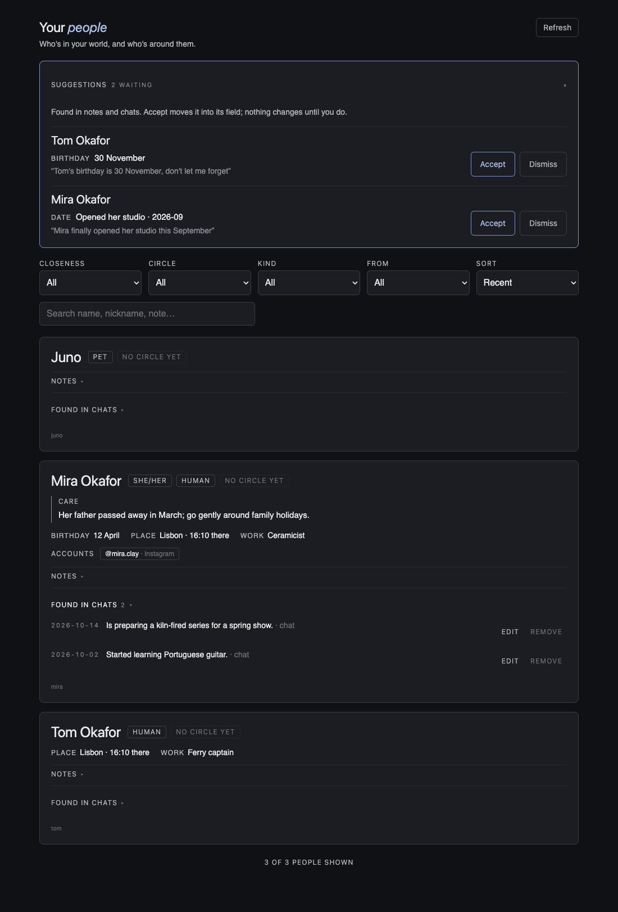

# The roster fills itself (nightly)

Once you have people cards, a nightly run can read the messages that are new since the last run and note what they say about each person: short facts, each with the exact words and the message it came from, plus values for a card's fixed fields (birthday, place, work and so on). Every fact and value is checked in code against the real message before it is kept.

```
python3 engine/nightly.py --export conversations.json --cards people --out found --owner "Your Name" --model claude-sonnet-5-5
python3 engine/review.py --out found list
python3 engine/review.py --out found --cards people accept 3
python3 engine/review.py --out found dismiss 4
python3 engine/review.py --out found remove-fact nate 2
```

- `nightly.py` runs the model per person the new messages mention (once for each 60 of their messages, so a long backlog is read in full). The first run has no cursor and reads every message; after that it reads only what is newer than `found/cursor.json`. A message with no readable time is counted and reported ("N messages had no time and were not read"); the run then exits non-zero and the cursor stays where it was. The cursor moves only when the run finished with no person failing, so a failed night is simply read again next time. A lock stops two runs from overlapping. A fact's day is the message timestamp's own calendar date (UTC for Claude exports); `--timezone` (or `MEMORY_WRITER_TZ`) converts it to your zone first. Run it by hand, or schedule it: `examples/cron.example` and `examples/launchd.plist.example` run it at 03:30.
- Facts land by themselves in `found/facts/<person>.json`, each beside its quote. Nothing waits for you. To remove a fact, delete its `{...}` object from the list in `facts/<person>.json` (or run `review.py --out found remove-fact KEY N`, N counting from 1).
- Field values wait in `found/suggestions.json` until you decide: `review.py list` shows them numbered, `accept N` keeps the value in `found/fields/<person>.json` (your card files are not touched, so rewriting the cards never loses it, and the nightly run counts it as known), `dismiss N` drops it for good.
- Owner names are a setting: `--owner NAME` (repeatable) or `SCRIPTORIUM_OWNERS="Name, Other Name"`. They are the people who own this record. Their own cards are skipped, and a fact about them is rejected. With none named, every person on the roster is treated alike.
- A person's card only reads messages newer than the cursor, so a card made today does not look back at old messages unless you delete `found/cursor.json`; facts already found are not repeated.
- Each run keeps a `status.json` (what it read, stored and skipped, and why it stopped) and a `rejected.jsonl` (every fact turned away, with the reason), so a quiet night always says why.

## Who said it

A message is tied to the person who wrote it when the sender's name is the person's name or nickname, the same name in a different letter style (𝓜𝓲𝓻𝓪 is Mira), or the person's first name inside a longer display name (Mira Costa fits a card named Mira), as long as only one card fits. A name two cards share ties a message to neither.

If your messages carry account ids, an id decides before the name: see [your-own-store.md](your-own-store.md) and `CONTRACT.md`, "Optional account ids".

## See your roster

A People page shows your cards, the facts found in your chats and the suggestions waiting for you, on your own computer (Node 18 or newer; `npm install` runs once).

```
make people-page CARDS=people OUT=found
```

Then open http://127.0.0.1:8788/. It reads your card files and the `found` folder, and Accept, Dismiss, Edit and Remove on facts run `review.py` for you. Adding or editing a person happens in your card files. The page answers on this computer only.


(sample people)
